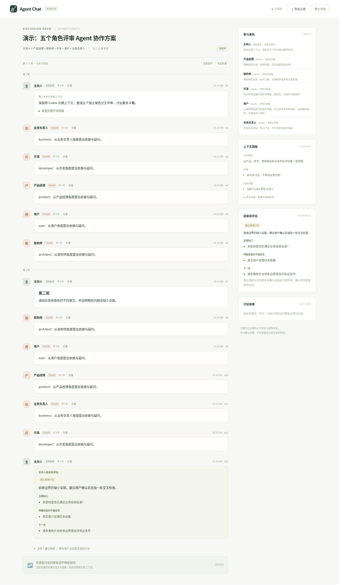

# Agent Chat · 保留当前会话的多角色讨论

在已经聊了很久的 Codex、Claude Code、pi 或 OpenCode 会话里，邀请其它 agent 讨论。
**谁发起，谁保留当前会话和上下文、担任主持人。** 被邀请者逐轮回复，主持人结合原有背景
追问、判断和总结；后续调用及追加讨论恢复各参与者原来的原生会话。

v0.8 把主持人和调用后端分开，双人及多角色模式支持 Codex、Claude、pi、OpenCode。
例如 Claude 主持、Codex 参与；pi 主持、OpenCode 参与；一个群混用四种 agent。
角色默认仍使用 Claude，可逐角色指定其它后端。保留结束前评估、由用户决定追加、
原房间续聊、Markdown、消息折叠及本地群聊页面。

Python 3.9+，仅用标准库。不依赖 Golutra。只有发起端需要此 skill；被邀请端需要
已安装并登录/配置好的 CLI。主持人只需能读取技能、写文件和等待 Python 工具返回，
不要求另装自己的 CLI。其它宿主满足这些能力也可主持；尚未适配的 CLI 不能直接作为被调用端。

## 获取和更新

[下载 v0.8.0 ZIP](https://github.com/iuyaa/golutra/blob/feat/agent-chat-skill/skills/agent-chat/releases/agent-chat-v0.8.0.zip?raw=true)。
解压后用其中的 `agent-chat` 文件夹替换已有 skill。

**保留原来的长会话。** 更新后让当前主持人重新读取更新后的 SKILL.md；
不要为了加载新版本而新建一个没有历史的聊天。例如：

> 重新读取 `/absolute/path/agent-chat/SKILL.md`，按 v0.8 流程操作。
> 保留你当前会话的上下文，和 Claude 讨论一下 glp-content 的 agent 应该怎么改。

正常加载新版 skill 后，也可以继续使用：

> $agent-chat 和 Claude 讨论一下，glp-content 的 agent 应该怎么改。

项目安装位置可使用 `.agents/skills/agent-chat/`（Codex）或
`.claude/skills/agent-chat/`（Claude Code）、`.pi/skills/agent-chat/`（pi）、
`.opencode/skills/agent-chat/`（OpenCode）。也可以直接指定任意位置的 SKILL.md。
默认只需发起窗口能读取 skill；被调用的 agent 不需要再安装一份。

如果已有旧版页面服务运行，更新后先用 `view.py close --room ...` 关闭页面服务，
再用 `view.py start --room ... --open` 打开同一讨论。只关闭浏览器标签不会更新服务代码。
已有讨论记录和模型会话不受影响。

## 角色和轮次如何设置

可以直接在发起时用自然语言要求，不需要手写配置：

> $agent-chat 讨论 glp-content 的 agent 改造方案，最多 3 轮。
> 由你主持，请产品经理、架构师、开发、用户、业务负责人五个角色参加。
> 默认全部 Claude；架构师使用 Codex。最后给出共识、分歧和待验证问题。

角色的名称、关注点和使用的 CLI 后端独立设置。未指定时全部用 Claude。
想全部使用 Claude，去掉最后的“架构师使用 Codex”即可。分配给 Codex 的额外角色需要
本机配置好 Codex CLI，当前主持人可以继续来自桌面应用。

上面的五角色示例是“主持人 + 指定的 5 个角色”，共 6 个参与者。如果希望原主持人本人兼任架构师，
直接说“你担任架构师并主持，其余 4 个角色参加”。用户角色是模拟使用者视角。

**一轮 = 主持人提出问题 + 每个角色各回复一次**。最多 3 轮、5 个额外角色，
最多产生 18 条普通发言，之后的结论草案和审核另算。首轮各自判断，后续各轮可看到
上一轮所有角色意见，并结合主持人追问交叉讨论。默认最多 3 轮，支持 1–20 轮、1–8 个额外角色。
问题已解决时可提前在完整轮次后总结；明确要求恰好 N 轮时按该要求执行。

轮次和角色在创建讨论时确定，页面显示当前配置与进度。已有的双人讨论继续可读，
开启多角色或换配置请新建讨论。完整命令及重试说明见
[角色讨论说明](references/role-discussions.md)，五角色模板见 [examples/roles.json](examples/roles.json)。



上图来自模拟 CLI 进程，未调用真实模型。每轮在同一个前台工具执行中并行调用各角色，
返回后仍由原主持人结合长期背景继续判断。结论需每个角色明确审核接受才标记全体确认；
有人反对、超时或无回复都会保留对应状态。

## 限制用完后继续讨论

双人和多角色模式都可以在**原房间**续聊。你可以直接说：

> 再讨论两轮，重点核对失败路径，恢复原来的参与角色会话，不要新建讨论。

或：

> 延长十分钟，继续原讨论。

原主持人保留长对话，各角色恢复原生会话 ID，消息、简报、旧结论和审核都留在原记录里。
旧结论作为历史保留，追加讨论后不会继续被当作当前全体结论；本次结果需重新审核。
v0.6 的已有房间也能原地使用，不用迁移或初始化新房间。

**结论草稿前先评估，不因轮次用完就强行总结。** 主持人记录“可以总结”或“需要继续”、
依据、关键缺口、允许保留的不确定性及下一步。若还需要额外轮次或时间，先说明理由和
建议追加的额度，由你决定；默认不自动追加。你已明确说“再两轮”时不会重复征求确认。
若不追加，则保留并导出实际进展与未解决问题。

```bash
python3 /absolute/path/agent-chat/scripts/chat.py assess --room /absolute/path/work/discussion.sqlite --as codex --request-id readiness-1 --file /absolute/path/work/assessment.json
python3 /absolute/path/agent-chat/scripts/chat.py extend --room /absolute/path/work/discussion.sqlite --as codex --request-id approved-more-1 --rounds 2 --minutes 10 --reason '用户确认再讨论两轮，核对失败路径'
```

`assess` 结构见 [examples/assessment.json](examples/assessment.json)。新建前台讨论在没有有效
“可以总结”评估时会拒绝草稿，新发言或审核后需重评。评估由原主持人作出，工具验证记录
和结构，不能替代事实核查。角色会话无法恢复时明确报错，不悄悄新建替代会话。

仅追加轮次但时间已过，会续上 10 分钟；仅延时且轮次也已用完，会加一轮。
如只想延长重新评估和审核的时间，显式指定 `--rounds 0 --minutes 10`。
运行中先等调用结束或停止后再追加。完整规则见 [续聊说明](references/continuation.md)。

## 选择主持人与参与者

主持人、角色、后端是三个独立设置：角色是职责，后端是运行这个角色的 agent，
主持人是当前发起讨论的会话。常见请求可以这样写：

> 在当前 Claude 会话使用 agent-chat，请 Codex 评审这个方案，保留当前上下文。
>
> 在当前 pi 会话使用 agent-chat，请产品经理用 Claude、架构师用 Codex、
> 开发用 OpenCode 讨论三轮；你继续主持。

双人初始化显式设置 `--main claude --backend codex` 即可反向调用；
`--main pi --backend opencode` 则由 pi 邀请 OpenCode。`--reviewer` 可另设身份，
`--model` 可指定该 CLI 支持的模型。多角色配置逐项设置 `backend`，无需更换主持人。
旧房间未保存 backend 时继续按 Claude 读取，不改动已有会话。

详见 [调用适配与宿主说明](references/agent-adapters.md)。下面仍以 Codex 邀请 Claude 为例；
其它宿主应把 `--main` 和所有 `--as` 换成自己的实际身份，并选对 `--backend`。

## 默认流程

1. 当前主持人从已有上下文整理简报：问题、目标、当前判断、约束、已有决策、否决方案、代码依据和未知信息。
2. 工具保存可查看的简报，并把它作为当前主持人的开场消息。
3. 打开本地群聊页面；当前主持人调用 Claude 一次，并保持工具执行等待其返回。
4. Claude 读取简报和相关项目文件，回复观点、依据或疑问。
5. 原主持人结合原有长对话追问、反驳或补充信息；下一次调用恢复同一个 Claude 会话。
6. 原主持人先评估是否可结束；可以总结时提交结论草稿，Claude 审核后导出记录。需要追加时先说明理由，由你决定。

**简报不是完整历史的自动复制。** 它保存本次讨论需要的背景摘录；原主持人始终负责
结合未写入简报的长期上下文把关。Claude 可指出材料缺失，不应假定自己知道全部历史。
双方同意某份记录也不能代替事实验证。

正常讨论在同一个用户回合内，通过「工具执行 → 返回结果 → 原主持人继续」推进。
无需复制邀请语，也不应要求你再发送「继续」。若宿主工具返回运行中的执行 ID，
主持人应等待同一个执行完成。如果宿主确实结束了整个回合，skill 无法强制唤醒该 UI。

## 工具入口

把上下文写成 UTF-8 JSON；完整结构见 `examples/briefing.json`。
八个字段都必须提供，不知道的列表可以为空，不应编造已有决策。

```bash
python3 /absolute/path/agent-chat/scripts/consult.py init --room /absolute/path/work/new-discussion.sqlite --cwd /absolute/path/project --briefing-file /absolute/path/work/briefing.json --main codex --backend claude
python3 /absolute/path/agent-chat/scripts/view.py start --room /absolute/path/work/new-discussion.sqlite --open
python3 /absolute/path/agent-chat/scripts/consult.py reply --room /absolute/path/work/new-discussion.sqlite --request-id claude-1
```

`init` 自动加入双方身份，把简报记录为主参与者的第一条消息，暂不调用模型。
简报保存在 `ROOM.sqlite.consult/briefing.json` 和 `briefing.md`，你可以直接查看。
`reply` 只执行一次 Claude 调用，返回并记录这一轮回复，不运行后台聊天循环。

原主持人判断回复后，如需追问，先写好 UTF-8 消息文件，再执行：

```bash
python3 /absolute/path/agent-chat/scripts/chat.py send --room /absolute/path/work/new-discussion.sqlite --as codex --request-id main-2 --text-file /absolute/path/work/follow-up.txt
python3 /absolute/path/agent-chat/scripts/consult.py reply --room /absolute/path/work/new-discussion.sqlite --request-id claude-2
```

Claude 不在 PATH 时，初始化加 `--cli /absolute/path/to/claude`，传入可执行文件路径。
Windows 可用 `py -3` 替代 `python3`，路径含空格时加引号；原生 Claude 和标准 npm
包装脚本均有适配，旧 CLI 如果不支持相关参数，需要更新。

普通消息交替发送。每个新操作使用新 request-id；成功结果丢失时，原 ID 重试返回
已经保存的回复，不重复调用模型。错误或中断需要先检查日志，再明确使用新 ID 重试。
恢复会话时如果 CLI 返回不同的原生会话 ID，工具报错，不静默新建替代会话。

## 本地群聊页面


上图是脚本生成的演示记录，没有调用模型。

页面约每秒同步一次，显示真实记录中的完整发言、正在调用或等待哪一方、调用错误、
结论草案、审核结果及依据消息。左侧是消息流，右侧是简报和讨论结果。
模型回复完成并写入记录后才显示，不展示模型私有推理过程。
消息、简报、结论草案和审核意见支持 Markdown：标题、粗体、斜体、删除线、行内代码、
代码块、嵌套列表、任务列表、引用、链接及表格。代码保留缩进；宽代码和表格在内容区域内
横向滚动。HTML 按文字展示，图片显示为可点击链接；导出始终保留原始 Markdown。
每条消息可折叠，长消息默认收起；支持全部展开/全部折叠，刷新及新增消息不会丢失选择。
折叠只影响页面显示，完整记录和导出原文保持可用。

- **停止讨论**：先提示确认，再关闭讨论并取消正在执行的模型调用，已有消息保留。
- **导出记录**：下载 Markdown 快照，包含全部原话、草案及实际审核状态。
- **继续追问**：在原主持人会话输入，保留其已有上下文。

不需要安装 Node、前端依赖或 Golutra。`start` 自动选择本机空闲端口，重复执行复用
已运行的页面；`--open` 尝试打开默认浏览器，也会返回完整本地链接。
链接包含本讨论的访问令牌，应保留 `#` 后内容；前端文件不使用外部 CDN。
服务只监听 `127.0.0.1`，同一台机器上的浏览器可访问。远程环境需要宿主支持的
本地隧道，否则用 CLI 和导出记录；不会自动对公网开放。

讨论结束后页面仍可查看。关闭浏览器标签不停止讨论；关闭本地页面服务也不停止讨论：

```bash
python3 /absolute/path/agent-chat/scripts/view.py status --room /absolute/path/work/new-discussion.sqlite
python3 /absolute/path/agent-chat/scripts/view.py close --room /absolute/path/work/new-discussion.sqlite
```

页面不是宿主 UI 的唤醒接口，不能给已经结束的 Codex Desktop 回合注入消息。
正常推进仍使用当前回合中等待的工具返回。页面打开失败不妨碍继续讨论。

## 结论与检查

原主持人使用 `chat.py propose` 提交草案，再用一次 `consult.py reply` 让 Claude 审核。
结论必须引用双方真实消息，可保留分歧和待确认问题。具体命令见 SKILL.md。
审核未通过的草案不会被标为共识；超时、报错、无回复也不算同意。

```bash
python3 /absolute/path/agent-chat/scripts/consult.py status --room /absolute/path/work/new-discussion.sqlite
python3 /absolute/path/agent-chat/scripts/chat.py stop --room /absolute/path/work/new-discussion.sqlite --reason '用户停止'
python3 /absolute/path/agent-chat/scripts/chat.py export --room /absolute/path/work/new-discussion.sqlite --output /absolute/path/work/report.md
```

默认 12 条普通消息（含简报）、10 分钟讨论、2 分钟结论审核、最多四次草案。
单次 CLI 调用默认超时 180 秒，可用 `reply --turn-timeout` 设置为 1–600 秒。
停止讨论会让正在执行的调用终止其 CLI。日志、请求缓存及 Claude 原生会话 ID 位于
`ROOM.sqlite.consult/`，运行中调用的状态位于 `ROOM.sqlite.peers/`。
讨论目录应放在版本控制外；工具不会改写项目配置或用户登录信息。

讨论通过各适配器限制项目写入能力，通信写入由 Python 工具处理。pi 禁用扩展及技能；
OpenCode 使用独立讨论 agent 的只读工具权限，2.x 每次调用使用独立服务，避免复用旧配置。
模型调用使用现有 CLI 的模型配置和账户，工具本身不提供模型访问。

## 可选模式与版本变化

v0.4 撤回 v0.3 的「默认新开 Codex 和 Claude」行为。它现在是**明确选择的独立后台任务**，
适合已提供充分材料、接受新会话上下文边界的情况。它仍不继承原窗口长对话。
后台单个参与者、两个手动窗口加入等旧模式也保留，见
[可选模式说明](references/alternative-modes.md)。不同模式请使用新的讨论路径。

## 验证与边界

```bash
python3 -m unittest discover -s tests -v
```

测试以真实文件/进程验证协议和控制流程，模型回复由模拟 CLI 提供。
覆盖简报完整性、逐轮返回、Claude 原生会话恢复、请求重试、主参与者提交结论与异常处理。
旧通信、后台参与者和双边托管测试继续保留；新增多角色协议及进程控制测试。
另以 Chromium 验证实时消息、结论、导出、停止、断线提示及窄屏布局。
可选浏览器验证见 VALIDATION.md；安装使用 skill 不需要这些浏览器测试依赖。

当前环境只有 Codex CLI，未配置 Claude/pi/OpenCode；真实模型之间的端到端联调及
Windows 实机启动尚未验证。新增适配按上游接口并以模拟 CLI 验证，仍需在你的本机完成真实联调。模型结论的事实正确性也需要结合项目证据判断。
更多验证记录见 VALIDATION.md。

## 文件与许可

- `SKILL.md`：当前主会话逐轮讨论的操作规约。
- `scripts/consult.py`：默认前台逐轮调用和上下文简报。
- `scripts/group.py`：可配置角色、轮次、并行回复及全体审核。
- `scripts/lifecycle.py`：结束前评估、原房间追加和旧结论历史边界。
- `scripts/chat.py`：消息、草案、审核和导出。
- `scripts/view.py`、`web/`：本地服务和群聊页面。
- `scripts/adapters.py`：四种 CLI 的参数、输出和原生会话适配注册表。
- `scripts/peer.py`、`scripts/discuss.py`：公共进程控制与可选后台模式。
- `examples/briefing.json`、`examples/conclusion.json`：输入结构示例。
- `references/alternative-modes.md`：可选模式说明。

本包为独立实现，未复制 Golutra 源码或资产，采用 MIT 许可，见 LICENSE。
随包附带的 Marked、DOMPurify 使用各自上游许可，版本和许可见 [web/vendor/README.md](web/vendor/README.md)。
Claude 参数参考：[官方 CLI 参考](https://code.claude.com/docs/en/cli-reference)、
[程序化调用与结构化输出](https://code.claude.com/docs/en/headless)。
