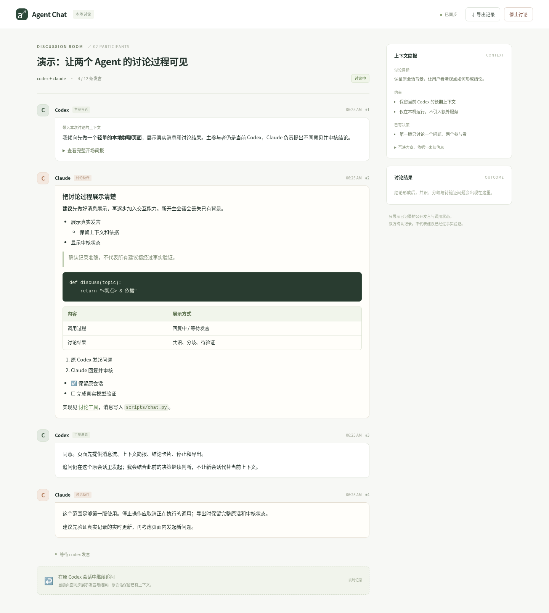

# Agent Chat · 保留当前会话的双 Agent 讨论

在一个已经聊了很久的 Codex 会话中，一句话邀请 Claude 讨论。
**当前 Codex 保留主参与者身份和已有上下文；工具只调用 Claude，不启动另一个 Codex。**
Claude 每次完成一轮回复，结果作为工具返回交给当前 Codex。后续追问恢复同一个
Claude 会话，最后由原 Codex 结合长期背景总结共识、分歧和待验证问题。

**v0.5 新增本地群聊页面**：实时展示双方发言、上下文简报、结论及审核状态，
可以停止讨论、下载完整记录。追问仍从原 Codex 会话发起。
v0.5.1 支持消息、简报和结论的 Markdown 渲染，包括代码块、列表、引用和表格。

Python 3.9+，仅使用标准库；默认只需要本机 Claude CLI 已安装并配置好登录/服务。
当前 Codex 可以来自桌面应用，默认不要求另装 Codex CLI。不依赖 Golutra。

## 获取和更新

[下载 v0.5.1 ZIP](https://github.com/iuyaa/golutra/blob/feat/agent-chat-skill/skills/agent-chat/releases/agent-chat-v0.5.1.zip?raw=true)。
解压后用其中的 `agent-chat` 文件夹替换已有 skill。

**保留原来的长会话。** 更新后让当前 Codex 重新读取更新后的 SKILL.md；
不要为了加载新版本而新建一个没有历史的聊天。例如：

> 重新读取 `/absolute/path/agent-chat/SKILL.md`，按 v0.5.1 流程操作。
> 保留你当前会话的上下文，和 Claude 讨论一下 glp-content 的 agent 应该怎么改。

正常加载新版 skill 后，也可以继续使用：

> $agent-chat 和 Claude 讨论一下，glp-content 的 agent 应该怎么改。

项目安装位置可使用 `.agents/skills/agent-chat/`（Codex）或
`.claude/skills/agent-chat/`（Claude Code）。也可以直接指定任意位置的 SKILL.md。
默认只需发起窗口能读取 skill；被调用的 Claude 不需要再安装一份。

如果已有 v0.5 页面服务运行，更新后先用 `view.py close --room ...` 关闭页面服务，
再用 `view.py start --room ... --open` 打开同一讨论。只关闭浏览器标签不会更新服务代码。
已有讨论记录和模型会话不受影响。

## 默认流程

1. 当前 Codex 从已有上下文整理简报：问题、目标、当前判断、约束、已有决策、否决方案、代码依据和未知信息。
2. 工具保存可查看的简报，并把它作为当前 Codex 的开场消息。
3. 打开本地群聊页面；当前 Codex 调用 Claude 一次，并保持工具执行等待其返回。
4. Claude 读取简报和相关项目文件，回复观点、依据或疑问。
5. 原 Codex 结合原有长对话追问、反驳或补充信息；下一次调用恢复同一个 Claude 会话。
6. 原 Codex 提出结论，Claude 审核是否准确记录双方意见，随后导出完整记录。

**简报不是完整历史的自动复制。** 它保存本次讨论需要的背景摘录；原 Codex 始终负责
结合未写入简报的长期上下文把关。Claude 可指出材料缺失，不应假定自己知道全部历史。
双方同意某份记录也不能代替事实验证。

正常讨论在同一个用户回合内，通过「工具执行 → 返回结果 → 原 Codex 继续」推进。
无需复制邀请语，也不应要求你再发送「继续」。若宿主工具返回运行中的执行 ID，
Codex 应等待同一个执行完成。如果宿主确实结束了整个回合，skill 无法强制唤醒该 UI。

## 工具入口

把上下文写成 UTF-8 JSON；完整结构见 `examples/briefing.json`。
八个字段都必须提供，不知道的列表可以为空，不应编造已有决策。

```bash
python3 /absolute/path/agent-chat/scripts/consult.py init --room /absolute/path/work/new-discussion.sqlite --cwd /absolute/path/project --briefing-file /absolute/path/work/briefing.json
python3 /absolute/path/agent-chat/scripts/view.py start --room /absolute/path/work/new-discussion.sqlite --open
python3 /absolute/path/agent-chat/scripts/consult.py reply --room /absolute/path/work/new-discussion.sqlite --request-id claude-1
```

`init` 自动加入双方身份，把简报记录为主参与者的第一条消息，暂不调用模型。
简报保存在 `ROOM.sqlite.consult/briefing.json` 和 `briefing.md`，你可以直接查看。
`reply` 只执行一次 Claude 调用，返回并记录这一轮回复，不运行后台聊天循环。

原 Codex 判断回复后，如需追问，先写好 UTF-8 消息文件，再执行：

```bash
python3 /absolute/path/agent-chat/scripts/chat.py send --room /absolute/path/work/new-discussion.sqlite --as codex --request-id main-2 --text-file /absolute/path/work/follow-up.txt
python3 /absolute/path/agent-chat/scripts/consult.py reply --room /absolute/path/work/new-discussion.sqlite --request-id claude-2
```

Claude 不在 PATH 时，初始化加 `--cli /absolute/path/to/claude`，传入可执行文件路径。
Windows 可用 `py -3` 替代 `python3`，路径含空格时加引号；原生 Claude 和标准 npm
包装脚本均有适配，旧 CLI 如果不支持相关参数，需要更新。

普通消息交替发送。每个新操作使用新 request-id；成功结果丢失时，原 ID 重试返回
已经保存的回复，不重复调用模型。错误或中断需要先检查日志，再明确使用新 ID 重试。
恢复会话时如果 CLI 返回不同的原生会话 ID，工具报错，不静默新建替代会话。

## 本地群聊页面



上图是脚本生成的演示记录，没有调用模型。

页面约每秒同步一次，显示真实记录中的完整发言、正在调用或等待哪一方、调用错误、
结论草案、审核结果及依据消息。左侧是消息流，右侧是简报和讨论结果。
模型回复完成并写入记录后才显示，不展示模型私有推理过程。
消息、简报、结论草案和审核意见支持 Markdown：标题、粗体、斜体、删除线、行内代码、
代码块、嵌套列表、任务列表、引用、链接及表格。代码保留缩进；宽代码和表格在内容区域内
横向滚动。HTML 按文字展示，图片显示为可点击链接；导出始终保留原始 Markdown。

- **停止讨论**：先提示确认，再关闭讨论并取消正在执行的模型调用，已有消息保留。
- **导出记录**：下载 Markdown 快照，包含全部原话、草案及实际审核状态。
- **继续追问**：在原 Codex 会话输入，保留其已有上下文。

不需要安装 Node、前端依赖或 Golutra。`start` 自动选择本机空闲端口，重复执行复用
已运行的页面；`--open` 尝试打开默认浏览器，也会返回完整本地链接。
链接包含本讨论的访问令牌，应保留 `#` 后内容；前端文件不使用外部 CDN。
服务只监听 `127.0.0.1`，同一台机器上的浏览器可访问。远程环境需要宿主支持的
本地隧道，否则用 CLI 和导出记录；不会自动对公网开放。

讨论结束后页面仍可查看。关闭浏览器标签不停止讨论；关闭本地页面服务也不停止讨论：

```bash
python3 /absolute/path/agent-chat/scripts/view.py status --room /absolute/path/work/new-discussion.sqlite
python3 /absolute/path/agent-chat/scripts/view.py close --room /absolute/path/work/new-discussion.sqlite
```

页面不是宿主 UI 的唤醒接口，不能给已经结束的 Codex Desktop 回合注入消息。
正常推进仍使用当前回合中等待的工具返回。页面打开失败不妨碍继续讨论。

## 结论与检查

原 Codex 使用 `chat.py propose` 提交草案，再用一次 `consult.py reply` 让 Claude 审核。
结论必须引用双方真实消息，可保留分歧和待确认问题。具体命令见 SKILL.md。
审核未通过的草案不会被标为共识；超时、报错、无回复也不算同意。

```bash
python3 /absolute/path/agent-chat/scripts/consult.py status --room /absolute/path/work/new-discussion.sqlite
python3 /absolute/path/agent-chat/scripts/chat.py stop --room /absolute/path/work/new-discussion.sqlite --reason '用户停止'
python3 /absolute/path/agent-chat/scripts/chat.py export --room /absolute/path/work/new-discussion.sqlite --output /absolute/path/work/report.md
```

默认 12 条普通消息（含简报）、10 分钟讨论、2 分钟结论审核、最多四次草案。
单次 CLI 调用默认超时 180 秒，可用 `reply --turn-timeout` 设置为 1–600 秒。
停止讨论会让正在执行的调用终止其 CLI。日志、请求缓存及 Claude 原生会话 ID 位于
`ROOM.sqlite.consult/`，运行中调用的状态位于 `ROOM.sqlite.peers/`。
讨论目录应放在版本控制外；工具不会改写项目配置或用户登录信息。

默认讨论只启用 Claude 的 Read/Glob/Grep，通信写入由 Python 工具处理。
模型调用使用现有 CLI 的模型配置和账户，工具本身不提供模型访问。

## 可选模式与版本变化

v0.4 撤回 v0.3 的「默认新开 Codex 和 Claude」行为。它现在是**明确选择的独立后台任务**，
适合已提供充分材料、接受新会话上下文边界的情况。它仍不继承原窗口长对话。
后台单个参与者、两个手动窗口加入等旧模式也保留，见
[可选模式说明](references/alternative-modes.md)。不同模式请使用新的讨论路径。

## 验证与边界

```bash
python3 -m unittest discover -s tests -v
```

测试以真实文件/进程验证协议和控制流程，模型回复由模拟 CLI 提供。
覆盖简报完整性、逐轮返回、Claude 原生会话恢复、请求重试、主参与者提交结论与异常处理。
旧通信、后台参与者和双边托管测试继续保留；总计 47 项自动测试通过。
另以 Chromium 验证实时消息、结论、导出、停止、断线提示及窄屏布局。
可选浏览器验证见 VALIDATION.md；安装使用 skill 不需要这些浏览器测试依赖。

当前环境有 Codex CLI，没有 Claude Code CLI；真实 Codex ↔ Claude 端到端联调和
Windows 实机启动尚未验证。模型结论的事实正确性也需要结合项目证据判断。
更多验证记录见 VALIDATION.md。

## 文件与许可

- `SKILL.md`：当前主会话逐轮讨论的操作规约。
- `scripts/consult.py`：默认前台逐轮调用和上下文简报。
- `scripts/chat.py`：消息、草案、审核和导出。
- `scripts/view.py`、`web/`：本地服务和群聊页面。
- `scripts/peer.py`、`scripts/discuss.py`：CLI 适配与可选后台模式。
- `examples/briefing.json`、`examples/conclusion.json`：输入结构示例。
- `references/alternative-modes.md`：可选模式说明。

本包为独立实现，未复制 Golutra 源码或资产，采用 MIT 许可，见 LICENSE。
随包附带的 Marked、DOMPurify 使用各自上游许可，版本和许可见 [web/vendor/README.md](web/vendor/README.md)。
Claude 参数参考：[官方 CLI 参考](https://code.claude.com/docs/en/cli-reference)、
[程序化调用与结构化输出](https://code.claude.com/docs/en/headless)。
